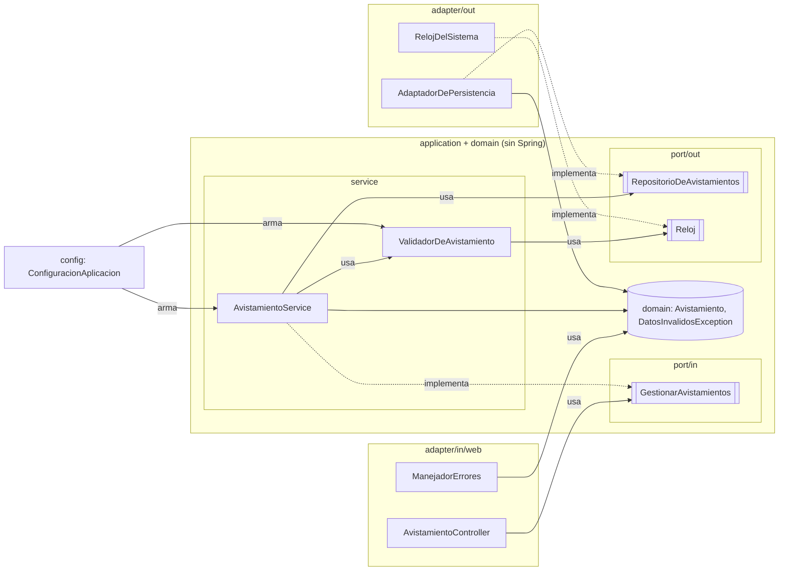
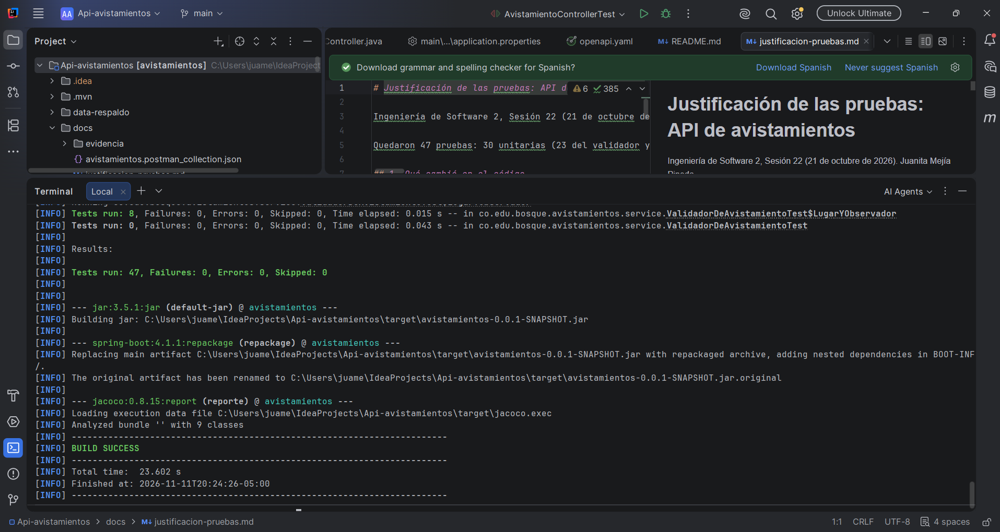
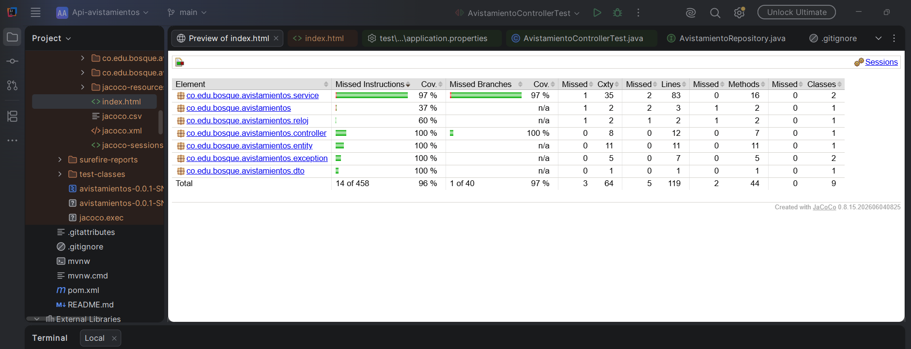
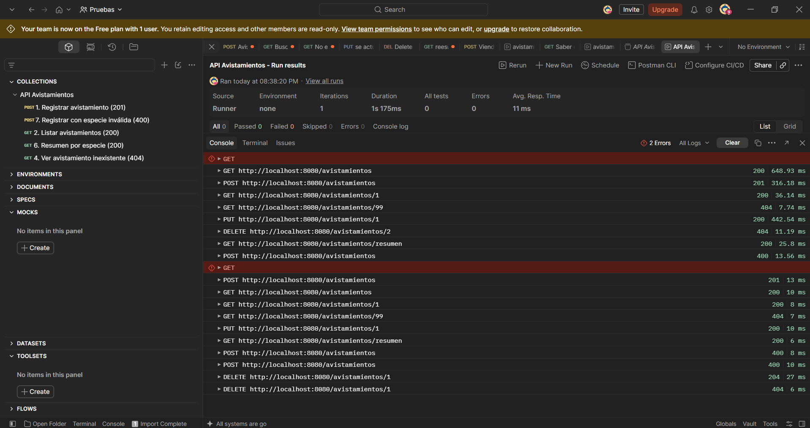
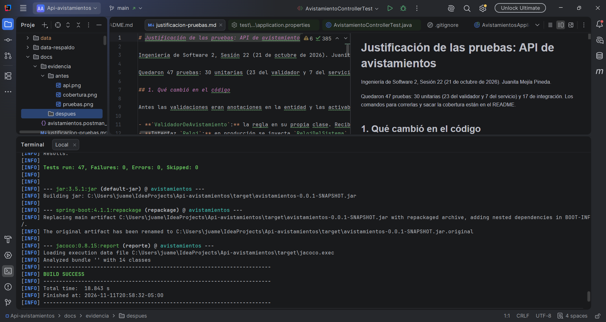
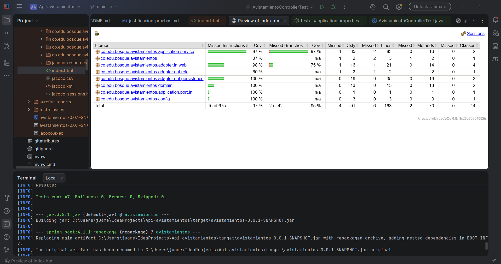
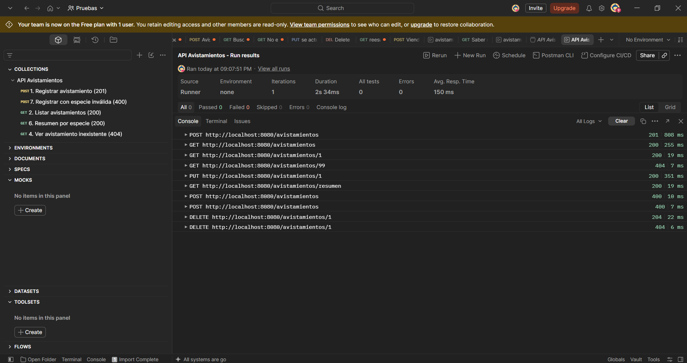

# Taller 5: Arquitectura hexagonal aplicada a la API de avistamientos

**Asignatura:** Ingeniería de Software 2 (ISW-2), Universidad El Bosque  
**Autora:** Juanita Mejía Pineda  
**Fecha:** 11 de noviembre de 2026  
**Repositorio:** https://github.com/JuaniMP/Api-avistamientos (rama `main`, el mismo del taller de pruebas unitarias y de integración)

## Resumen

Este documento presenta la investigación sobre tres arquitecturas que ponen las reglas de negocio en el centro del sistema (hexagonal [1], Clean Architecture [2] y de cebolla [3]) y su aplicación a la API REST de registro de avistamientos de aves, construida con Spring Boot y H2. Se eligió la arquitectura hexagonal y el código se reorganizó en cinco commits incrementales. Las 47 pruebas automatizadas pasan antes y después del refactor, la cobertura de instrucciones pasa de 96 % a 97 % y las 10 peticiones de la colección de Postman responden con los mismos códigos HTTP.

## 1. Investigación

### 1.1 Problema, puertos, adaptadores y simetría según Cockburn

**Problema.** Cockburn identifica que la lógica de negocio se filtra hacia la interfaz de usuario. Esto impide probar la aplicación de forma automática, porque las pruebas quedan atadas a detalles visuales que cambian con frecuencia, e impide que la aplicación sea manejada por otro programa o por un proceso por lotes. Agregar una capa adicional no lo resuelve, porque nada obliga a respetar la separación y con el tiempo la lógica se vuelve a mezclar [1]. Del lado de la base de datos aparece el mismo problema: si la base no está disponible, el desarrollo se detiene. Según el autor, ambos problemas tienen la misma causa: la lógica de negocio acoplada a los elementos externos [1].

**Puerto.** Es un punto de comunicación entre la aplicación y el exterior, definido por el propósito de la conversación y expresado como una API (por ejemplo, "registrar un avistamiento" o "guardar datos") [1].

**Adaptador.** Es el componente que traduce entre la API de un puerto y una tecnología concreta: interfaz gráfica, prueba automatizada, script o base de datos. Un mismo puerto admite varios adaptadores [1].

**Simetría.** La distinción relevante no es izquierda/derecha ni arriba/abajo, sino **interior/exterior**. La aplicación es el interior; tanto el usuario que la maneja como la base de datos que ella usa están en el exterior y se conectan de la misma forma, mediante puertos y adaptadores. Por eso la interfaz se puede reemplazar por una prueba y la base real por una implementación en memoria sin modificar la aplicación [1]. La representación por capas apiladas oculta esta simetría; la forma hexagonal solo busca dejar espacio para varios puertos y sus seis lados no tienen significado [1].

### 1.2 Círculos de Clean Architecture y regla de dependencia

Martin representa la arquitectura como círculos concéntricos [2]. La Tabla I resume su contenido, del más interno al más externo.

**Tabla I.** Círculos de Clean Architecture [2]

| Círculo | Contenido |
|---|---|
| Entities | Reglas de negocio de toda la organización; lo que menos cambia ante cambios externos |
| Use Cases | Reglas propias de la aplicación; coordinan el flujo de datos hacia y desde las entidades |
| Interface Adapters | Conversión de datos entre el formato de los casos de uso y el de los agentes externos: controladores, presentadores, vistas y código de acceso a la base |
| Frameworks and Drivers | Base de datos, framework web y demás herramientas; principalmente código de enlace |

El número de círculos no es fijo; puede haber más o menos siempre que se cumpla la regla de dependencia [2].

**Regla de dependencia.** Las dependencias del código fuente solo pueden apuntar hacia adentro. Un círculo interno no puede conocer nada de un círculo externo: no puede nombrar funciones, clases ni variables declaradas afuera, ni usar formatos de datos definidos afuera, en especial los generados por un framework [2].

### 1.3 Resolución de la contradicción entre caso de uso y persistencia

La contradicción se resuelve con el **principio de inversión de dependencias**. El caso de uso declara en su propio círculo una interfaz con la operación que necesita, y la capa externa la implementa. En tiempo de ejecución el flujo de control va de adentro hacia afuera, pero en el código fuente la dependencia apunta hacia adentro, porque es la implementación externa la que conoce la interfaz [2]. Martin lo ilustra con un caso de uso que invoca a un presentador por medio de un puerto de salida [2]. Es la aplicación directa del principio de inversión de dependencias de SOLID, formulado originalmente por Martin en dos partes: los módulos de alto nivel no deben depender de los de bajo nivel, sino ambos de abstracciones, y las abstracciones no deben depender de los detalles, sino los detalles de las abstracciones [4], [5]. La arquitectura de cebolla aplica el mismo mecanismo: las interfaces de repositorio se definen en el núcleo y su implementación queda en la capa de infraestructura, inyectada en ejecución [3].

La Fig. 1 muestra el mecanismo aplicado en la API.

```
AvistamientoService  ──usa──▶  RepositorioDeAvistamientos   (interfaz, application/port/out)
                                          ▲
                                          │ implementa
                              AdaptadorDePersistencia       (adapter/out/persistence, JPA)
```

*Fig. 1. Inversión de dependencias entre el caso de uso y la persistencia.*

El servicio invoca `repositorio.guardar(...)` sin conocer JPA ni H2. Un cambio de motor de base de datos (por ejemplo, a PostgreSQL) solo afecta al adaptador.

### 1.4 Comparación entre hexagonal, cebolla y Clean Architecture

**Elementos comunes.** Las tres arquitecturas ubican las reglas de negocio en el centro, orientan las dependencias hacia ese centro, tratan la base de datos, la interfaz y los frameworks como detalles reemplazables en el borde y usan interfaces definidas en el núcleo e implementadas afuera [1], [2], [3]. Palermo declara que su propuesta parte de la misma premisa que la hexagonal [3], y Martin presenta Clean Architecture como una integración de ambas en una sola idea [2].

El fundamento de las tres es anterior. Parnas propuso descomponer un sistema en módulos que oculten las decisiones de diseño con mayor probabilidad de cambiar (ocultamiento de información) [6]; en esta API, la decisión de usar JPA y H2 queda oculta detrás de un puerto. Evans, por su parte, recomienda aislar el modelo de dominio de la interfaz de usuario y de la infraestructura para que el código de negocio no se mezcle con ellas [7], y Vernon presenta la arquitectura hexagonal como uno de los estilos adecuados para aplicar ese aislamiento en el diseño guiado por el dominio [8].

**Diferencias.** La Tabla II resume las diferencias.

**Tabla II.** Comparación de las tres arquitecturas

| Criterio | Hexagonal [1] | Cebolla [3] | Clean Architecture [2] |
|---|---|---|---|
| Vocabulario | Puertos, adaptadores, interior/exterior | Capas concéntricas, modelo de dominio, infraestructura | Entities, Use Cases, Interface Adapters, Frameworks and Drivers |
| Capas | No divide el interior; solo interior y exterior | Modelo de dominio al centro, capas de comportamiento alrededor (número variable), interfaz, infraestructura y pruebas afuera | Cuatro círculos con nombre, número no obligatorio |
| Énfasis | Manejar y probar la aplicación desde cualquier actor externo | Evitar el acoplamiento con el acceso a datos, que cambia cada pocos años | Una única regla para todo el diagrama: la regla de dependencia |

### 1.5 Pertinencia de Clean Architecture para una API pequeña

**Posición.** Aplicar Clean Architecture completa no se justifica para la API en su estado actual; la variante de puertos y adaptadores sí se justifica, y por eso se eligió la arquitectura hexagonal.

Bass, Clements y Kazman plantean que la modificabilidad tiene un costo: los mecanismos que facilitan los cambios futuros (encapsular, restringir dependencias, usar intermediarios) cuestan al introducirse, y solo se justifican si ese costo es menor que el de hacer los cambios esperados sin ellos [9]. Con ese criterio se evalúa la API.

**Costo (trade-off).** El número de clases pasó de 9 a 14 (según JaCoCo) para la misma funcionalidad. El avistamiento quedó representado por tres clases con los mismos campos (`domain/Avistamiento`, `AvistamientoEntidadJpa` y `AvistamientoResponse`), con código de conversión campo a campo entre ellas, y seguir una petición POST requiere recorrer más archivos. Aplicar Clean Architecture de forma estricta, con presentadores y modelos de entrada y salida por caso de uso [2], aumentaría todavía más el número de clases para 6 endpoints y una regla de validación.

**Beneficio.** El servicio y la regla de negocio quedaron independientes de Spring y de JPA. Las pruebas unitarias del servicio reemplazan una interfaz propia (`RepositorioDeAvistamientos`) en lugar de Spring Data, lo que coincide con la recomendación de Freeman y Pryce de crear dobles de prueba solo de los tipos que el equipo controla y no de los de librerías externas [10]. Cambiar el motor de base de datos o el formato del JSON solo afecta a un adaptador, sin modificar el núcleo ni sus 30 pruebas unitarias. Este es el objetivo planteado por Cockburn: probar y operar la aplicación sin la base de datos ni la interfaz reales [1].

**Conclusión.** Si la API crece (más reglas, otro motor de base de datos, otros clientes), la separación compensa su costo. Si se mantiene como un CRUD de una sola tabla, la estructura tradicional controlador–servicio–repositorio es suficiente.

## 2. Aplicación

### 2.1 Arquitectura seleccionada

Se seleccionó la **arquitectura hexagonal (puertos y adaptadores)** [1], porque solo exige separar interior y exterior y no obliga a definir capas que en esta API quedarían vacías. Se usa únicamente su vocabulario, como muestra la Tabla III.

**Tabla III.** Correspondencia entre conceptos de la arquitectura hexagonal y paquetes

| Concepto hexagonal | Paquete | Rol |
|---|---|---|
| Interior: dominio | `domain` | Modelo de dominio y error de negocio |
| Interior: aplicación | `application/service` | Casos de uso y regla de validación |
| Puerto de entrada | `application/port/in` | Lo que la aplicación ofrece |
| Puerto de salida | `application/port/out` | Lo que la aplicación necesita (persistencia y fecha actual) |
| Adaptador de entrada | `adapter/in/web` | API REST |
| Adaptador de salida | `adapter/out/persistence`, `adapter/out/reloj` | JPA/H2 y reloj del sistema |
| Configuración | `config` | Conexión de adaptadores y puertos al arrancar |

### 2.2 Estructura del código

```
src/main/java/co/edu/bosque/avistamientos/
├── AvistamientosApplication.java
├── domain/
│   ├── Avistamiento.java
│   └── DatosInvalidosException.java
├── application/
│   ├── port/in/
│   │   ├── GestionarAvistamientos.java
│   │   └── DatosAvistamiento.java
│   ├── port/out/
│   │   ├── RepositorioDeAvistamientos.java
│   │   └── Reloj.java
│   └── service/
│       ├── AvistamientoService.java
│       └── ValidadorDeAvistamiento.java
├── adapter/
│   ├── in/web/
│   │   ├── AvistamientoController.java
│   │   ├── AvistamientoRequest.java
│   │   ├── AvistamientoResponse.java
│   │   └── ManejadorErrores.java
│   └── out/
│       ├── persistence/
│       │   ├── AdaptadorDePersistencia.java
│       │   ├── AvistamientoEntidadJpa.java
│       │   └── AvistamientoRepositorioJpa.java
│       └── reloj/
│           └── RelojDelSistema.java
└── config/
    └── ConfiguracionAplicacion.java
```

*Fig. 2. Estructura de paquetes después del refactor.*

**Tabla IV.** Responsabilidad de cada clase

| Clase | Responsabilidad |
|---|---|
| `Avistamiento` | Modelo de dominio; clase Java pura, sin anotaciones de JPA ni de Swagger |
| `DatosInvalidosException` | Error de negocio con el mapa campo → mensaje |
| `GestionarAvistamientos` | Puerto de entrada: listar, obtener, resumen, crear, actualizar y eliminar |
| `DatosAvistamiento` | Datos de entrada para crear o actualizar, sin dependencia de la web |
| `RepositorioDeAvistamientos` | Puerto de salida de persistencia |
| `Reloj` | Puerto de salida que entrega la fecha actual |
| `AvistamientoService` | Implementa el puerto de entrada: valida, convierte y persiste |
| `ValidadorDeAvistamiento` | Regla de negocio de validación |
| `AvistamientoController` | Adaptador REST entre HTTP y el puerto de entrada |
| `AvistamientoRequest` / `AvistamientoResponse` | Formato JSON de entrada y salida (con anotaciones de Swagger) |
| `ManejadorErrores` | Convierte `DatosInvalidosException` en respuesta 400 |
| `AdaptadorDePersistencia` | Implementa el puerto de salida con Spring Data JPA |
| `AvistamientoEntidadJpa` / `AvistamientoRepositorioJpa` | Entidad JPA (tabla `avistamiento`) y repositorio de Spring Data |
| `RelojDelSistema` | Implementa `Reloj` con `LocalDate.now()` |
| `ConfiguracionAplicacion` | Crea el servicio y el validador y les inyecta los adaptadores |

Las pruebas se reubicaron junto a sus clases: `application/service/` (unitarias del validador y del servicio), `application/port/out/RelojFijo.java` (stub del reloj) y `AvistamientoControllerTest` (integración) en el paquete raíz.

### 2.3 Dirección de las dependencias



*Fig. 3. Diagrama de dependencias. Las flechas sólidas indican uso y las punteadas, implementación de una interfaz.*

Todas las dependencias que cruzan el borde del hexágono apuntan hacia adentro, en cumplimiento de la regla de dependencia [2]. Los adaptadores conocen los puertos, pero ninguna clase de `application` ni de `domain` importa algo de `adapter`, de `config` ni de Spring. Se verificó revisando las sentencias `import`: en `application` y `domain` solo aparecen paquetes `java.*` y del propio núcleo.

### 2.4 Evolución del código

El refactor se hizo en commits incrementales, sin cambiar el comportamiento en ninguno (Tabla V).

**Tabla V.** Commits del taller

| N.º | Commit | Cambio |
|---|---|---|
| 1 | Evidencia antes del refactor | Capturas de pruebas, cobertura y Postman antes de modificar el código |
| 2 | Refactor paso 1 | Creación de `domain`, `application` y `adapter`; reubicación de clases sin cambios de lógica |
| 3 | Refactor paso 2 | Puerto de salida `RepositorioDeAvistamientos` y `AdaptadorDePersistencia`; el servicio deja de depender de Spring Data |
| 4 | Refactor paso 3 | Modelo de dominio puro; la persistencia usa `AvistamientoEntidadJpa` y la web `AvistamientoResponse` |
| 5 | Refactor paso 4 | Puerto de entrada `GestionarAvistamientos` y `DatosAvistamiento`; el controlador deja de conocer la clase del servicio |
| 6 | Refactor paso 5 | Se eliminan `@Service` y `@Component` del núcleo; `ConfiguracionAplicacion` realiza la conexión |
| 7 | Evidencia después del refactor | Las mismas capturas con el código reorganizado |

### 2.5 Evidencia de funcionamiento y cobertura

**Tabla VI.** Resultados antes y después del refactor

| Métrica | Antes | Después |
|---|---|---|
| Pruebas ejecutadas | 47 (0 fallos, 0 errores) | 47 (0 fallos, 0 errores) |
| Cobertura de instrucciones | 96 % (14 de 458 sin cubrir) | 97 % (16 de 675 sin cubrir) |
| Cobertura de ramas | 97 % (1 de 40 sin cubrir) | 95 % (2 de 42 sin cubrir) |
| Clases analizadas por JaCoCo | 9 | 14 |
| Códigos HTTP de la colección de Postman (10 peticiones) | 201, 200, 200, 404, 200, 200, 400, 400, 204, 404 | 201, 200, 200, 404, 200, 200, 400, 400, 204, 404 |

La rama adicional sin cubrir corresponde a la condición `if (r == null)` del controlador al convertir `AvistamientoRequest` en `DatosAvistamiento`. Spring nunca entrega un cuerpo nulo, porque el cuerpo es obligatorio y su ausencia produce un 400 antes de llegar al método, por lo que ninguna prueba ejecuta esa rama.













### 2.6 Principales dificultades de la separación

**Clase `Avistamiento`.** Antes del refactor una sola clase cumplía tres funciones: tabla de la base de datos (`@Entity`), formato JSON de respuesta (con `@Schema` de Swagger) y modelo de trabajo del servicio. Para que el dominio no dependiera de JPA ni de Swagger, como pide la regla de dependencia [2] y la recomendación de aislar el dominio [7], fue necesario dividirla en tres clases (`domain/Avistamiento`, `AvistamientoEntidadJpa` y `AvistamientoResponse`) e implementar la conversión entre ellas en los adaptadores, sin cambios observables desde el exterior. La tabla conservó su nombre (`@Table(name = "avistamiento")`) para no perder los datos existentes, y la respuesta conservó el mismo JSON y el mismo nombre de esquema en OpenAPI (`@Schema(name = "Avistamiento")`).

**Entrada del validador.** El validador recibía `AvistamientoRequest`, que es el formato del JSON y tiene anotaciones de Swagger, es decir, un elemento del adaptador web. Mantenerlo así habría dejado el núcleo dependiendo del exterior. Se resolvió con `DatosAvistamiento` en `application/port/in`, y el controlador hace la conversión. En consecuencia, las pruebas unitarias del validador y del servicio cambiaron de tipo (`AvistamientoRequest` → `DatosAvistamiento`) y los mocks cambiaron de nombre de método (`save` → `guardar`, `existsById` → `existe`), pero verifican los mismos casos con los mismos resultados esperados.

## Referencias

[1] Cockburn, A. (2005). Hexagonal architecture. https://alistair.cockburn.us/hexagonal-architecture/ (secciones Intent, Motivation y Nature of the solution).

[2] Martin, R. C. (2012). The Clean Architecture. https://blog.cleancoder.com/uncle-bob/2012/08/13/the-clean-architecture.html (artículo corto. El libro de 2017, Clean Architecture, capítulos 22 y 30 a 34, lo
amplía).

[3] Palermo, J. (2008). The Onion Architecture: part 1. https://jeffreypalermo.com/2008/07/the-onion-architecture-part-1/ (hay partes 2 a 4, opcionales)

[4] R. C. Martin, *Clean Architecture: A Craftsman's Guide to Software Structure and Design*. Upper Saddle River, NJ, USA: Prentice Hall, 2017.

[5] R. C. Martin, "The Dependency Inversion Principle," *C++ Report*, vol. 8, 1996.

[6] D. L. Parnas, "On the criteria to be used in decomposing systems into modules," *Communications of the ACM*, vol. 15, no. 12, pp. 1053–1058, Dec. 1972.

[7] E. Evans, *Domain-Driven Design: Tackling Complexity in the Heart of Software*. Boston, MA, USA: Addison-Wesley, 2003.

[8] V. Vernon, *Implementing Domain-Driven Design*. Upper Saddle River, NJ, USA: Addison-Wesley, 2013.

[9] L. Bass, P. Clements, and R. Kazman, *Software Architecture in Practice*, 4th ed. Boston, MA, USA: Addison-Wesley, 2021.

[10] S. Freeman and N. Pryce, *Growing Object-Oriented Software, Guided by Tests*. Upper Saddle River, NJ, USA: Addison-Wesley, 2009.
