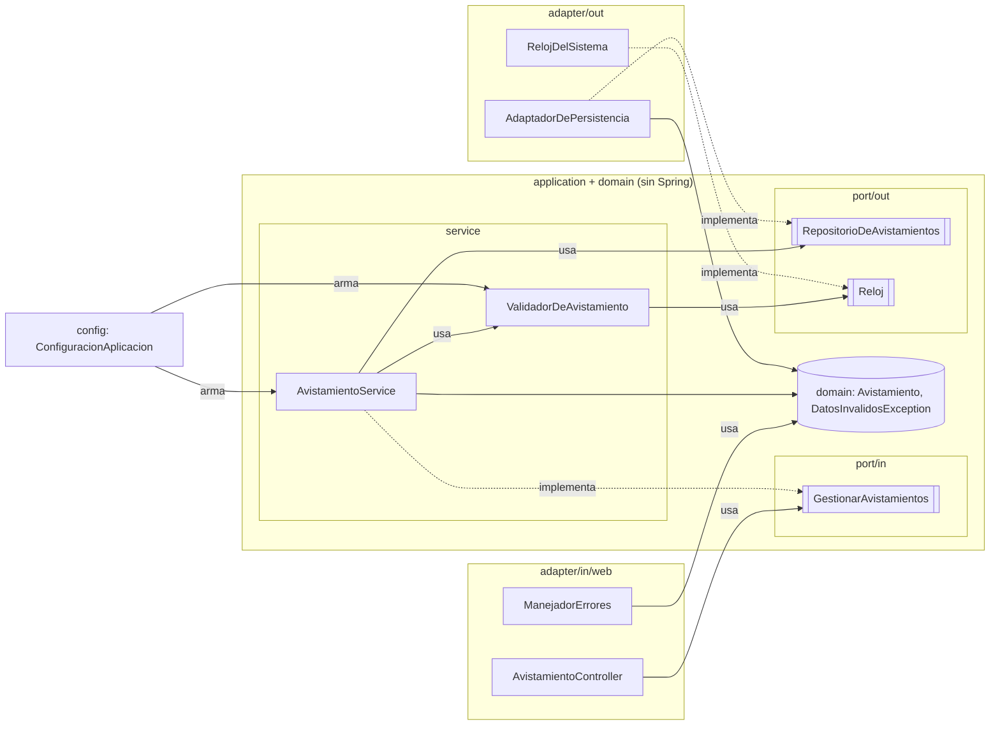

# Taller 5: Clean Architecture y arquitectura hexagonal

Ingeniería de Software 2, 11 de noviembre de 2026. Juanita Mejía Pineda.

**Repositorio:** https://github.com/JuaniMP/Api-avistamientos (rama `main`). Es el mismo repositorio del taller de pruebas unitarias y de integración.

## Parte 1. Investigación

### 1. El problema que ve Cockburn, puertos, adaptadores y la simetría

El problema que plantea Cockburn es que la lógica de negocio se termina metiendo en la interfaz de usuario. Cuando eso pasa, la aplicación no se puede probar de forma automática (las pruebas quedan amarradas a detalles visuales que cambian todo el tiempo), no se puede manejar desde otro programa o desde un proceso por lotes, y aunque se agregue una capa más, con el tiempo la lógica se vuelve a filtrar porque nada obliga a respetar esa separación (Cockburn, 2005). Él dice que del lado de la base de datos pasa lo mismo: si la base se cae o la están cambiando, los desarrolladores no pueden seguir trabajando, y para él los dos problemas tienen la misma raíz, que es la lógica enredada con lo externo (Cockburn, 2005).

Un **puerto** es un punto por donde la aplicación conversa con el exterior, definido por el propósito de esa conversación y expresado como una API (por ejemplo, "registrar un avistamiento" o "guardar datos"). Un **adaptador** es el que traduce entre esa API y una tecnología concreta: una interfaz gráfica, una prueba automática, un script, una base de datos. A un mismo puerto se le pueden conectar varios adaptadores (Cockburn, 2005).

La **simetría** viene de que, para él, lo importante no es izquierda contra derecha ni arriba contra abajo, sino **adentro contra afuera**: la aplicación es el adentro y todo lo demás está afuera, tanto el usuario que la maneja como la base de datos que ella usa. Los dos lados se conectan igual, por puertos y adaptadores, y por eso se puede cambiar la interfaz por una prueba o la base real por una falsa en memoria sin tocar la aplicación (Cockburn, 2005). Dibujarlo como capas apiladas esconde eso; el hexágono es solo para que quepan varios puertos, los seis lados no significan nada (Cockburn, 2005).

### 2. Los círculos de Clean Architecture y la regla de dependencia

Martin (2012) lo dibuja con cuatro círculos, de adentro hacia afuera:

- **Entities:** las reglas de negocio de toda la empresa, lo que menos cambia cuando cambia algo externo.
- **Use Cases:** las reglas propias de la aplicación; coordinan los datos que entran y salen de las entidades.
- **Interface Adapters:** convierten los datos entre el formato que les sirve a los casos de uso y el que les sirve a lo externo. Ahí van los controladores, presentadores, vistas y el código que adapta la base de datos.
- **Frameworks and Drivers:** lo de más afuera: la base de datos, el framework web y demás herramientas, casi siempre solo código de pegamento.

También aclara que no tienen que ser exactamente cuatro círculos; pueden ser más o menos, mientras se respete la regla (Martin, 2012).

La **regla de dependencia** dice que las dependencias del código fuente solo pueden apuntar hacia adentro. Lo que está en un círculo interno no puede saber nada de lo que está en uno externo: no puede nombrar una clase, función o variable declarada afuera, y tampoco puede usar formatos de datos de afuera, sobre todo los que genera un framework (Martin, 2012).

### 3. Cómo guarda datos el caso de uso sin depender de la base

Con **inversión de dependencias**. El caso de uso define en su propio círculo una interfaz con lo que necesita (por ejemplo "guardar avistamiento") y la capa de afuera la implementa. En ejecución el control va de adentro hacia afuera (el caso de uso termina llamando a la base), pero en el código la dependencia apunta hacia adentro, porque la clase de la base es la que conoce la interfaz y no al revés (Martin, 2012). Martin lo explica con el caso de uso que llama a un presentador a través de un puerto de salida, y la idea es la misma del principio de inversión de dependencias de SOLID: los módulos de alto nivel no dependen de los de bajo nivel, los dos dependen de abstracciones (Martin, 2017). Palermo propone lo mismo para la cebolla: las interfaces de repositorio van en el núcleo y la implementación queda en la capa de infraestructura, que se inyecta en ejecución (Palermo, 2008).

En mi API quedó así:

```
AvistamientoService  ──usa──▶  RepositorioDeAvistamientos (interfaz, en application/port/out)
                                          ▲
                                          │ implementa
                              AdaptadorDePersistencia (adapter/out/persistence, usa JPA)
```

El servicio llama a `repositorio.guardar(...)` sin saber que por detrás hay JPA y H2. Si mañana cambio H2 por PostgreSQL, solo cambia el adaptador.

### 4. Hexagonal, cebolla y Clean Architecture

**En común:** las tres ponen las reglas de negocio en el centro, hacen que las dependencias apunten hacia ese centro, dejan la base de datos, la interfaz y los frameworks en el borde como detalles reemplazables, y usan interfaces definidas adentro que se implementan afuera (Cockburn, 2005; Palermo, 2008; Martin, 2012). Palermo dice que su idea parte de la misma premisa que la hexagonal (Palermo, 2008), y Martin presenta Clean Architecture como una forma de juntar esas arquitecturas en una sola idea (Martin, 2012).

**Lo que cambia:**

- **El vocabulario:** Cockburn habla de puertos, adaptadores y de adentro/afuera (Cockburn, 2005). Palermo habla de capas de una cebolla, con el modelo de dominio en el centro e infraestructura afuera (Palermo, 2008). Martin habla de entidades, casos de uso, adaptadores de interfaz y frameworks (Martin, 2012).
- **El número de capas:** la hexagonal no divide el adentro en capas, solo separa adentro y afuera (Cockburn, 2005). La cebolla tiene el modelo de dominio en el centro, alrededor capas con más comportamiento (el número puede variar) y afuera la interfaz, la infraestructura y las pruebas (Palermo, 2008). Clean propone cuatro círculos con nombre, aunque aclara que no es un número fijo (Martin, 2012).
- **El énfasis:** Cockburn se enfoca en que la aplicación se pueda manejar y probar desde cualquier lado (Cockburn, 2005); Palermo, en no acoplar todo a la capa de acceso a datos, que cambia cada pocos años (Palermo, 2008); Martin, en una sola regla para todo el diagrama, la de dependencia (Martin, 2012).

### 5. ¿Se justifica en una API tan pequeña?

Mi posición: **aplicar Clean Architecture completa no se justifica para esta API como está hoy, pero la versión liviana (puertos y adaptadores) sí**, y por eso elegí la hexagonal.

**Costo concreto:** pasé de 9 a 14 clases (según JaCoCo) para hacer exactamente lo mismo. Ahora el avistamiento existe tres veces con los mismos campos: `domain/Avistamiento`, `AvistamientoEntidadJpa` para la base y `AvistamientoResponse` para el JSON, con código que copia campo por campo entre ellas. Para entender qué pasa en un POST hay que pasar por más archivos que antes. Si hubiera seguido Clean al pie de la letra, con presentadores y un modelo de entrada y uno de salida por cada caso de uso, serían todavía más clases para 6 endpoints y una regla (Martin, 2012).

**Beneficio concreto:** el servicio y la regla de negocio ya no dependen de Spring ni de JPA. Las pruebas unitarias del servicio usan un mock de una interfaz mía (`RepositorioDeAvistamientos`), no de Spring Data. Cambiar H2 por otra base o cambiar el formato del JSON solo toca un adaptador, y el núcleo y sus 30 pruebas unitarias no se enteran. Es justo lo que buscaba Cockburn: poder probar y manejar la aplicación sin la base ni la interfaz real (Cockburn, 2005).

Si la API va a crecer (más reglas, otra base, otro tipo de cliente), la separación se paga sola. Si se va a quedar en un CRUD de una tabla, la estructura tradicional de controller, service y repository era suficiente.

## Parte 2. Aplicación

### Arquitectura elegida: hexagonal (puertos y adaptadores)

Elegí la hexagonal porque solo pide separar adentro y afuera, sin obligar a inventar capas que en una API de una regla quedarían vacías. Usé solo su vocabulario: `domain` y `application` son el adentro; `port/in` y `port/out` son los puertos; `adapter/in` y `adapter/out` son los adaptadores; `config` es lo que conecta todo al arrancar.

### Cómo quedó organizado el código

```
src/main/java/co/edu/bosque/avistamientos/
├── AvistamientosApplication.java
├── domain/                                  ADENTRO: no depende de nada
│   ├── Avistamiento.java                    Modelo de dominio, clase Java pura (sin JPA ni Swagger)
│   └── DatosInvalidosException.java         Error de negocio con el mapa campo → mensaje
├── application/                             ADENTRO: casos de uso y puertos (sin Spring)
│   ├── port/in/
│   │   ├── GestionarAvistamientos.java      Puerto de entrada: listar, obtener, resumen, crear, actualizar, eliminar
│   │   └── DatosAvistamiento.java           Lo que llega para crear o actualizar
│   ├── port/out/
│   │   ├── RepositorioDeAvistamientos.java  Puerto de salida: guardar y consultar
│   │   └── Reloj.java                       Puerto de salida: qué día es hoy
│   └── service/
│       ├── AvistamientoService.java         Implementa GestionarAvistamientos
│       └── ValidadorDeAvistamiento.java     La regla de negocio
├── adapter/                                 AFUERA: tecnologías concretas
│   ├── in/web/
│   │   ├── AvistamientoController.java      Adaptador REST: HTTP ↔ GestionarAvistamientos
│   │   ├── AvistamientoRequest.java         JSON que llega (con anotaciones de Swagger)
│   │   ├── AvistamientoResponse.java        JSON que sale (mismos campos de antes)
│   │   └── ManejadorErrores.java            DatosInvalidosException → 400
│   └── out/
│       ├── persistence/
│       │   ├── AdaptadorDePersistencia.java      Implementa RepositorioDeAvistamientos con JPA
│       │   ├── AvistamientoEntidadJpa.java       @Entity, misma tabla "avistamiento"
│       │   └── AvistamientoRepositorioJpa.java   Spring Data
│       └── reloj/
│           └── RelojDelSistema.java         Implementa Reloj con LocalDate.now()
└── config/
    └── ConfiguracionAplicacion.java         Crea el servicio y el validador y les conecta los adaptadores
```

Las pruebas se movieron con sus clases: `application/service/` (unitarias del validador y del servicio), `application/port/out/RelojFijo.java` (el stub del reloj) y `AvistamientoControllerTest` (integración) en la raíz.

### Dirección de las dependencias



Todas las flechas que cruzan el borde apuntan hacia adentro. El controlador y los adaptadores de salida conocen los puertos, pero nada de `application` ni de `domain` importa algo de `adapter`, de `config` ni de Spring. Lo revisé buscando los `import`: en `application` y `domain` solo hay imports de `java.*` y del mismo núcleo.

### Cómo fue evolucionando (commits)

| Commit | Qué hace |
|---|---|
| Evidencia antes del refactor | Capturas de pruebas, cobertura y Postman antes de tocar el código |
| Refactor paso 1 | Crea `domain`, `application` y `adapter` y mueve cada clase a su paquete, sin cambiar lógica |
| Refactor paso 2 | Puerto de salida `RepositorioDeAvistamientos` y `AdaptadorDePersistencia`: el servicio deja de depender de Spring Data |
| Refactor paso 3 | Modelo de dominio puro; la base usa `AvistamientoEntidadJpa` y la web `AvistamientoResponse` |
| Refactor paso 4 | Puerto de entrada `GestionarAvistamientos` y `DatosAvistamiento`: el controlador ya no conoce la clase del servicio |
| Refactor paso 5 | Se quitan `@Service` y `@Component` del núcleo; `ConfiguracionAplicacion` lo arma |
| Evidencia después del refactor | Las mismas capturas, ya con el código nuevo |

### Evidencia antes y después

| | Antes | Después |
|---|---|---|
| Pruebas | 47, 0 fallos, 0 errores | 47, 0 fallos, 0 errores |
| Cobertura de instrucciones | 96 % (14 de 458 sin cubrir) | 97 % (16 de 675 sin cubrir) |
| Cobertura de ramas | 97 % (1 de 40 sin cubrir) | 95 % (2 de 42 sin cubrir) |
| Clases analizadas por JaCoCo | 9 | 14 |
| Colección de Postman (10 peticiones) | 201, 200, 200, 404, 200, 200, 400, 400, 204, 404 | 201, 200, 200, 404, 200, 200, 400, 400, 204, 404 |

La rama nueva sin cubrir es el `if (r == null)` del controlador cuando convierte el JSON en `DatosAvistamiento`. Spring nunca le pasa `null` porque el cuerpo es obligatorio (si no llega, responde 400 antes), así que ninguna prueba entra ahí.

**Antes del refactor**


**Después del refactor**


En la captura de Postman de antes también sale arriba una corrida de otra colección mía; la que cuenta es la de abajo, la de las 10 peticiones de `API Avistamientos`.

### Qué fue lo más difícil de separar y por qué

**La clase `Avistamiento`.** Antes era una sola clase que hacía tres trabajos: era la tabla de la base (`@Entity`), era el JSON que devolvía la API (con `@Schema` de Swagger) y era con lo que trabajaba el servicio. Para que el dominio no dependa de JPA ni de Swagger hubo que partirla en tres (`domain/Avistamiento`, `AvistamientoEntidadJpa` y `AvistamientoResponse`) y escribir la conversión entre ellas en los adaptadores, cuidando que nada se notara desde afuera: la tabla se tuvo que dejar con el mismo nombre (`@Table(name = "avistamiento")`) para no perder los datos guardados, y la respuesta tenía que dar el mismo JSON y el mismo esquema en OpenAPI (`@Schema(name = "Avistamiento")`).

**La entrada del validador.** El validador recibía `AvistamientoRequest`, que es el formato del JSON y tiene anotaciones de Swagger, o sea algo de la web. Si lo dejaba así, el núcleo seguía dependiendo del adaptador web. Lo resolví con `DatosAvistamiento` en `application/port/in`, y el controlador convierte una cosa en la otra. Por eso las pruebas unitarias del validador y del servicio cambiaron de tipo (`AvistamientoRequest` → `DatosAvistamiento`) y los mocks cambiaron de nombre de método (`save` → `guardar`, `existsById` → `existe`), pero siguen probando exactamente los mismos casos con los mismos resultados esperados.

## Referencias

- Cockburn, A. (2005). *Hexagonal architecture*. https://alistair.cockburn.us/hexagonal-architecture/
- Martin, R. C. (2012, 13 de agosto). *The Clean Architecture*. The Clean Code Blog. https://blog.cleancoder.com/uncle-bob/2012/08/13/the-clean-architecture.html
- Martin, R. C. (2017). *Clean Architecture: A Craftsman's Guide to Software Structure and Design*. Prentice Hall.
- Palermo, J. (2008). *The Onion Architecture: part 1*. https://jeffreypalermo.com/2008/07/the-onion-architecture-part-1/
